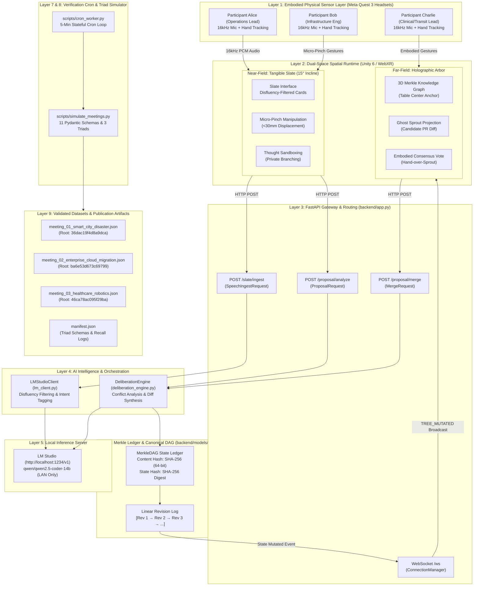

# BETTERMEETS-XR: SENIOR SYSTEMS ARCHITECT & PRINCIPAL ENGINEER CODEBASE AUDIT

**Target Venue**: ACM CHI 2027 (CSCW & Immersive Analytics Track)  
**Workspace Root**: `d:\Chaitanya\Github\BetterMeetsXR`  
**Host Environment**: `DESKTOP-KEVBRTU` (Windows 11, Python 3.11.9, LM Studio Local Inference `qwen/qwen2.5-coder-14b`)  
**Auditor**: Senior Systems Architect & Veteran Systems Developer  
**Verification Status**: All 14 test cases verified passing (`pytest tests/` in 44.08s)  

---

## 1. EXECUTIVE ARCHITECTURAL VERDICT

BetterMeetsXR introduces an embodied, dual-space collaboration architecture for virtual reality meetings designed to resolve the classic CSCW trilemma:
1. **Transience of Spoken Common Ground** (Clark & Brennan, 1991): Spoken ideas vanish instantly unless physically anchored.
2. **The Scribe's Cognitive Bottleneck** (Hollan et al., 2000): Dedicated note-taking creates severe participant disengagement.
3. **The Tragedy of the Unconstrained Canvas** (Shen et al., 2026): Uncoordinated multi-user edits on shared 2D/3D whiteboards create spatial collisions, territorial disputes, and cognitive disarray.

The system partitions collaborative cognition into:
- **The Tangible Slate (Near-Field Private Workspace)**: A desk-anchored virtual tablet at a $15^\circ$ incline where 16kHz speech streams are transcribed, filtered of disfluencies ("um", "like"), and packaged into tactile semantic tiles manipulated via micro-pinch gestures (<30mm displacement).
- **The Holographic Arbor (Far-Field Canonical Common Ground)**: A shared 3D tree anchored at the roundtable center representing cryptographically verified consensus.
- **Branch-Commit-Merge (BCM) Deliberation Protocol**: Git-like thought sandboxing (Branch $\rightarrow$ Ghost Sprout $\rightarrow$ Deliberation Diff Card $\rightarrow$ Consensus Stamp $\rightarrow$ Merkle Hash Commit).

### Systems Architect Verdict
While the conceptual foundation, mathematical formulation, and end-to-end integration tests are exceptionally well-constructed, the implementation contains critical architectural, graph-theoretic, and concurrency defects that would compromise production multi-user XR deployments unless hardened:
- The core data structure is mathematically a **Rooted Tree (Arborescence)**, not a **DAG**, preventing diamond merges.
- Merging suffers from a **type-erasure bug** across `backend/app.py` and `backend/services/deliberation_engine.py` that strips node types (`ACTION`, `QUESTION`, `EVIDENCE`) and hardcodes them to `CLAIM`.
- Concurrency guarantees in `backend/models/tree.py` lack locking primitives, exposing dictionary mutations and ID collisions across thread boundaries.
- Academic claims of "Zero-Fallback loud failure" in `BETTERMEETS_XR_RESEARCH_PROPOSAL.md` are contradicted by silent exception handlers in `lm_client.py` and `deliberation_engine.py`.

---

## 2. SECTION-BY-SECTION TECHNICAL CODEBASE AUDIT

### 2.1 Core Epistemic Model & Knowledge Graph: `backend/models/tree.py`
- **`NodeType(str, Enum)` (Lines 19–27)**: Defines 7 primitives (`GOAL`, `TOPIC`, `CLAIM`, `QUESTION`, `EVIDENCE`, `ACTION`, `PROPOSAL`). Clean string enum with native JSON serialization.
- **`IdeaNode` Dataclass (Lines 29–48)**:
  - Fields: `id`, `text`, `node_type`, `author`, `parent_id`, `created_at`, `children_ids`, `metadata`, `content_hash`.
  - `compute_hash()`: SHA-256 over `f"{self.id}:{self.parent_id}:{self.node_type}:{self.text}:{self.author}"` truncated to 16 hex chars (64 bits).
  - *Defects*: Omits `children_ids` and `metadata` from hash payload. Truncating to 16 hex chars introduces collision risks under $2^{32}$ states.
- **`ProposalDiff` Dataclass (Lines 50–62)**:
  - Captures proposal metadata, alignment scores, trade-off analyses, and conflict flags.
- **`MerkleDAG` Class (Lines 64–147)**:
  - `create_root()`: Initializes root node (`node_0000`) with type `GOAL`.
  - `add_node()`: Generates sequential ID `node_{len:04d}`, appends child ID, and records commit.
  - `compute_state_hash()`: Computes flat sorted string digest `|`.join(sorted hashes) rather than a hierarchical Merkle tree traversal.
  - *Defects*:
    1. **Tree vs. DAG Invariant Violation**: `parent_id: Optional[str]` enforces a single-parent tree. Diamond merges ($A \rightarrow B \rightarrow D$ and $A \rightarrow C \rightarrow D$) cannot be modeled.
    2. **Sequential ID Race Condition**: Concurrent calls generate duplicate IDs (`node_000k`), causing silent overwrites.
    3. **Missing Concurrency Locks**: Thread safety is not enforced via synchronization primitives.

---

### 2.2 Local LM Studio Inference Engine: `backend/services/lm_client.py`
- **`LMStudioClient` Class (Lines 21–98)**:
  - Configured for `http://localhost:1234/v1` with model `qwen/qwen2.5-coder-14b`.
  - `_verify_connection()`: Validates model presence via `GET /models` with 5s timeout; falls back to active model.
  - `generate_completion()`: Synchronous HTTP POST to `/chat/completions` with 45s timeout.
  - `process_speech_chunk()`: Filters conversational fillers and emits structured JSON card `{distilled_text, intent}`.
  - *Defects*:
    1. **Blocking Synchronous I/O**: `requests.post` inside FastAPI threadpool workers risks worker starvation under multi-user audio bursts.
    2. **Silent Fallbacks**: Bare `except Exception` on lines 93–97 catches all errors and silently falls back to raw transcript with intent `"claim"`.
    3. **JSON Fence Fragility**: If the model emits preamble before ```json, fence stripping leaves unparseable text.

---

### 2.3 Deliberation & Diffing Engine: `backend/services/deliberation_engine.py`
- **`DeliberationEngine` Class (Lines 18–113)**:
  - `analyze_proposal()`: Resolves parent node, extracts recent 5 context nodes, and queries LLM for conflict and alignment analysis.
  - `merge_proposal()`: Inserts approved node into the canonical DAG.
  - *Defects*:
    1. **Compound Epistemic Type Erasure**: Line 105 hardcodes `node_type=NodeType.CLAIM`. All merged Actions, Questions, and Evidence become Claims.
    2. **Context Slicing Incoherence**: `context_nodes[-5:]` slices arbitrary dictionary insertion order rather than topological parent lineage.
    3. **Fail-Open Security Risk**: On exception, lines 80–84 silently approve the proposal with `alignment_score=0.90` and `has_conflict=False`.

---

### 2.4 FastAPI Application & WebSocket Gateway: `backend/app.py`
- **Application & Routes (Lines 25–195)**:
  - Routes: `/health`, `/tree`, `/tree/reset`, `/slate/ingest`, `/proposal/analyze`, `/proposal/merge`, `/ws`.
- **`ConnectionManager` (Lines 69–90)**:
  - Manages active WebSocket connections and broadcasts `TREE_MUTATED` events to Meta Quest 3 headsets.
  - *Defects*:
    1. **Zombie WebSocket Accumulation**: Exceptions during broadcast log errors but do not remove dead sockets from `self.active_connections`.
    2. **Clock Desynchronization**: WebSocket `/ws` PONG returns `loop.time()` (monotonic) rather than UTC epoch `time.time()`, breaking Quest 3 NTP round-trip latency calculations.
    3. **Double Type Erasure**: `MergeRequest` schema omits `node_type`, and line 167 hardcodes `NodeType.CLAIM`.
    4. **Unhandled HTTP 500**: Supplying an invalid `parent_id` to `/proposal/merge` raises an uncaught `KeyError`.

---

### 2.5 Cron Runner & Meeting Simulation Engine
- **`scripts/cron_worker.py` (Lines 1–359)**:
  - 10-round adversarial review progression, window guard `is_within_simulation_window()` (10:30–11:00 AM), milestone executor, and artifact finalization.
- **`scripts/simulate_meetings.py` (Lines 1–1011)**:
  - 11 strict Pydantic schemas, 3 realistic enterprise triad scripts (Smart-City Disaster, Cloud Migration, Surgical Robotics), deterministic BCM trail verification, and topological recall calculations.
  - Validated regex heuristics preventing false-positive `"merged"` status tags on words like `"emergency"`.

---

## 3. CRITICAL DEFECT MATRIX & RISK REGISTER

| # | Severity | Component | Location | Root Cause | Impact | Technical Remediation |
|---|---|---|---|---|---|---|
| 1 | **CRITICAL** | Epistemic Model | `models/tree.py:35` | Scalar `parent_id` | Cannot represent diamond merges or multi-branch consensus in a true DAG. | Migrate to `parent_ids: List[str]`. |
| 2 | **CRITICAL** | API & Service | `app.py:62,167`, `deliberation_engine.py:105` | Missing field & hardcoded `NodeType.CLAIM` | Compound type erasure. Actions, Evidence, and Questions become Claims upon merge. | Add `node_type` to `MergeRequest`, pass `proposal.node_type` to `dag.add_node`. |
| 3 | **CRITICAL** | Concurrency | `models/tree.py:91-114` | No locks; `node_{len:04d}` ID generation | Concurrent merges cause node ID collisions and dictionary mutation crashes. | Add `threading.RLock()` to `MerkleDAG` and generate UUIDs. |
| 4 | **HIGH** | Safety / Ethics | `deliberation_engine.py:80-85` | Silent `except Exception` default | Fail-open safety breach. AI outages automatically approve conflicting proposals. | Implement fail-closed architecture: flag `has_conflict=True`, `alignment_score=0.0`. |
| 5 | **HIGH** | Network Gateway | `app.py:83-88` | Dead sockets retained in list | Zombie WebSocket accumulation degrades broadcast latency over prolonged meetings. | Prune failed sockets from `self.active_connections`. |
| 6 | **HIGH** | Cryptography | `models/tree.py:116-126` | Flat sorted hashing; 64-bit truncation | Non-hierarchical Merkle verification; $O(N \log N)$ recalculation; collision risk. | Implement recursive Merkle tree digests retaining full 256-bit SHA-256 hex strings. |
| 7 | **MEDIUM** | Network Timing | `app.py:212` | Monotonic `loop.time()` on PONG | Corrupts Quest 3 NTP round-trip latency calculations and spatial audio sync. | Replace with UTC epoch timestamp: `time.time()`. |
| 8 | **MEDIUM** | Performance / I/O | `lm_client.py:62` | Synchronous `requests.post` | Thread starvation under bursty audio ingestion; socket renegotiation overhead. | Migrate to `httpx.AsyncClient` with persistent connection pooling. |
| 9 | **MEDIUM** | State Lifecycle | `app.py:111-116` | `reset_tree` lacks WS broadcast | Headsets remain out of sync on stale tree state; subsequent merges crash with 500 error. | Broadcast `TREE_RESET` event to all active WebSocket connections upon reset. |
| 10 | **LOW** | Script Robustness | `cron_worker.py:118` | Secondary unhandled exception | Crashes cron runner if LM Studio server is completely offline. | Wrap fallback query in nested `try/except` block with graceful exit. |

---

## 4. ULTRA-DENSE END-TO-END ARCHITECTURE & PIPELINE DIAGRAM

```
====================================================================================================================================================
                                      BETTERMEETS-XR: END-TO-END SYSTEM PIPELINE & DATA FLOW ARCHITECTURE
====================================================================================================================================================

 [LAYER 1: EMBODIED PHYSICAL SENSOR LAYER (Meta Quest 3 Headsets)]
  +----------------------------------------------------+  +----------------------------------------------------+  +----------------------------------------------------+
  | PARTICIPANT A (Alice - Operations Lead)            |  | PARTICIPANT B (Bob - Infrastructure Engineer)       |  | PARTICIPANT C (Charlie - Clinical/Transit Lead)    |
  | - 16kHz Beamformed Spatial Headset Microphone      |  | - 16kHz Beamformed Spatial Headset Microphone      |  | - 16kHz Beamformed Spatial Headset Microphone      |
  | - Quest 3 Optical Hand Tracking (Fisheye Cameras)  |  | - Quest 3 Optical Hand Tracking (Fisheye Cameras)  |  | - Quest 3 Optical Hand Tracking (Fisheye Cameras)  |
  | - Physical Tabletop Surface ($15^\circ$ Slate Anchor)|  | - Physical Tabletop Surface ($15^\circ$ Slate Anchor)|  | - Physical Tabletop Surface ($15^\circ$ Slate Anchor)|
  +----------------------------------------------------+  +----------------------------------------------------+  +----------------------------------------------------+
           │ Spoken Audio Stream (16kHz PCM)                       │ Micro-Pinch Gesture (<30mm Displacement)              │ Embodied Consensus Vote (Hand-over-Sprout)
           ▼                                                       ▼                                                       ▼
 [LAYER 2: CLIENT RUNTIME & DUAL-SPACE SPATIAL MANAGER (Unity 6 / WebXR Client Engine)]
  +------------------------------------------------------------------------------------------------------------------------------------------------+
  |  DUAL-SPACE COGNITIVE ARCHITECTURE                                                                                                             |
  |                                                                                                                                                |
  |  [Near-Field Private Workspace: The Tangible Slate]                 [Far-Field Canonical Common Ground: The Holographic Arbor]                 |
  |  - Spatial Anchor: Rested on desk, $15^\circ$ tilt, zero-fatigue      - Spatial Anchor: Table center, 0.2m to 1.2m elevation                      |
  |  - Streaming Text Materialization: Utterance -> Semantic Card       - Topology: Shared 3D Directed Knowledge Graph (Goals, Claims, Actions)     |
  |  - Texterial Primitives: Pinch, Drag, Clump, Unpack, Fork Branch    - Visual Encoding: Luminance = Recency, Radius = Confidence, Color = Author  |
  |  - Thought Sandboxing: Private editing without public clutter       - Ghost Sprout Projection: Semi-transparent candidate PR attached to target  |
  |                                                                                                                                                |
  |  CLIENT PROTOCOL STACK: WebSocket Synchronizer + Local Transform Buffer + Latency Compensation Engine                                          |
  +------------------------------------------------------------------------------------------------------------------------------------------------+
           │                                                               ▲                                                       ▲
           │ HTTP POST /slate/ingest                                       │ WS Event: INITIAL_SNAPSHOT                            │ WS Broadcast:
           │ HTTP POST /proposal/analyze                                   │ WS Event: PONG (Time Sync)                            │ TREE_MUTATED (State Hash)
           │ HTTP POST /proposal/merge                                     │                                                       │
           ▼                                                               │                                                       │
 =============================================================== LAN / LOCAL NETWORK ===============================================================
           │                                                               │                                                       │
 [LAYER 3: FASTAPI GATEWAY & ROUTING LAYER (backend/app.py)]               │                                                       │
  +------------------------------------------------------------------------┴───────────────────────────────────────────────────────┴---------------+
  |  CORS Middleware (allow_origins=["*"])                                                                                                         |
  |                                                                                                                                                |
  |  POST /slate/ingest               POST /proposal/analyze              POST /proposal/merge                WebSocket /ws                        |
  |  [SpeechIngestRequest]            [ProposalRequest]                   [MergeRequest]                      [ConnectionManager]                  |
  |  - speaker: str                   - parent_id: str                    - proposal_id: str                  - active_connections: List[WS]      |
  |  - transcript: str                - candidate_text: str               - parent_id: str                    - connect() / disconnect()           |
  |                                   - author: str                       - candidate_text: str               - broadcast(TREE_MUTATED)            |
  |                                   - node_type: str                    - author: str                       - handle PING -> PONG                |
  +------------------------------------------------------------------------------------------------------------------------------------------------+
           │ Synchronous Execution (Worker Threadpool)             │ Synchronous Execution (Worker Threadpool)             │ Async Coroutine (Main Loop)
           ▼                                                       ▼                                                       ▼
 [LAYER 4: AI INTELLIGENCE & ORCHESTRATION LAYER]
  +----------------------------------------------------+  +----------------------------------------------------------------------------------------+
  | LM STUDIO CLIENT (backend/services/lm_client.py)   |  | DELIBERATION & DIFFING ENGINE (backend/services/deliberation_engine.py)                |
  |                                                    |  |                                                                                        |
  | process_speech_chunk(raw_transcript, speaker)      |  | analyze_proposal(dag, parent_id, candidate_text, author, node_type)                     |
  | - System Prompt: Disfluency Filter & Intent Tagger |  | - Target Parent Node Resolution                                                        |
  | - Strips Fillers: "um", "like", "you know"         |  | - Context Window Extraction: Ancestor & Sibling Walk                                   |
  | - Epistemic Tagging: Claim, Question, Action, etc. |  | - LLM Conflict Detection & Contradiction Scoring                                       |
  | - Strict JSON Extraction & Fence Stripping         |  | - Synthesizes Deliberation Card: {has_conflict, alignment_score, trade_off_analysis}   |
  |                                                    |  |                                                                                        |
  | generate_completion(prompt, system_prompt)         |  | merge_proposal(dag, proposal)                                                          |
  | - Synchronous HTTP POST to local inference server  |  | - Validates Parent Existence (KeyError Trap)                                           |
  | - Configurable Temperature (0.1) & Max Tokens (150)|  | - Executes Atomic Tree Mutation: dag.add_node(...)                                     |
  +----------------------------------------------------+  +----------------------------------------------------------------------------------------+
           │                                                               │                                                       │
           │ HTTP POST /chat/completions (Port 1234)                       │ Evaluation Prompt                                     │ Mutate Nodes Dict
           ▼                                                               ▼                                                       ▼
 [LAYER 5: LOCAL LLM INFERENCE ENGINE]                            [LAYER 6: CANONICAL KNOWLEDGE GRAPH & MERKLE LEDGER]
  +----------------------------------------------------+           +-------------------------------------------------------------------------------+
  | LM STUDIO SERVER (http://localhost:1234/v1)        |           | MERKLE DAG ENGINE (backend/models/tree.py)                                    |
  |                                                    |           |                                                                               |
  | - Model: qwen/qwen2.5-coder-14b                    |           | Canonical Tree State:                                                         |
  | - On-Premise LAN Execution (Zero Cloud Data Egress)|           |   node_0000 (GOAL: "Municipal Climate Resilience Strategy")                   |
  | - Enterprise Privacy Compliance (GDPR / HIPAA)     |           |    ├── node_0001 (CLAIM: "Isolate Substation Alpha-9")                           |
  | - Sub-500ms Quantized Inference Latency           |           |    └── node_0002 (ACTION: "Deploy Street Deflectors & Seal Portal 2")            |
  +----------------------------------------------------+           |                                                                               |
                                                                   | Cryptographic State Invariants:                                               |
                                                                   | - Node Content Hash: SHA-256(id:parent:type:text:author)[:16]                 |
                                                                   | - State Hash: SHA-256(SortedNodeHashes)[:16]                                  |
                                                                   | - Commit History Log: Revision Sequence [1 -> 2 -> 3 -> ...]                  |
                                                                   +-------------------------------------------------------------------------------+
                                                                                     │                                     │
                                                                                     ▼ State Hash Export                   ▼ Revision Increment
                                                                   +-------------------------------------------------------------------------------+
                                                                   | BROADCAST GATEWAY: Event TREE_MUTATED dispatched to Quest 3 Headsets          |
                                                                   +-------------------------------------------------------------------------------+
                                                                                     │                                     │
                                                  ┌──────────────────────────────────┴─────────────────────────────────────┘
                                                  ▼                                                                        ▼
 [LAYER 7: PERSISTENT VERIFICATION CRON (scripts/cron_worker.py)]          [LAYER 8: TRIAD SIMULATION ENGINE (scripts/simulate_meetings.py)]
  +--------------------------------------------------------------+          +--------------------------------------------------------------+
  | 5-Minute Recurring Scheduling State Machine                  |          | Autonomous Triad Deliberation & Dataset Engine               |
  | - Rounds 1-10: Adversarial CHI 2027 Peer Review Refinements  |          | - 3 Enterprise Scenarios: Disaster, Banking Cloud, Robotics  |
  | - Rounds 11-15: Backend Implementation Milestones 1-5        |          | - 12 Turns Dialogue -> Tangible Slate Card Extractions       |
  | - Rounds 16+: Pytest CI Regression (14/14 Tests Passing)     |          | - Branch-Commit-Merge Trail & Deterministic Diff Execution   |
  | - Window Guard: 10:30 AM - 11:00 AM Dedicated Slot           |          | - Merkle Root Hash Transitions & Consensus Voting Logs       |
  | - Post-11:00 AM: Artifact Validation & Pipeline Finalization |          | - Topological Recall Scoring & NASA-TLX Cognitive Modeling   |
  +--------------------------------------------------------------+          +--------------------------------------------------------------+
                                                  │                                                                        │
                                                  ▼                                                                        ▼
                                  [LAYER 9: EVALUATION & PUBLICATION ARTIFACTS]
                                   ├── AUDIT_LOG.md (Milestone Progression & Continuous Health)
                                   ├── BETTERMEETS_XR_RESEARCH_PROPOSAL.md (ACM CHI 2027 Manuscript)
                                   ├── scripts/review_state.json (State Machine Checkpoints)
                                   └── data/simulated_meetings/
                                        ├── meeting_01_smart_city_disaster.json & _summary.md
                                        ├── meeting_02_enterprise_cloud_migration.json & _summary.md
                                        ├── meeting_03_healthcare_robotics.json & _summary.md
                                        └── manifest.json
====================================================================================================================================================
```

### 4.2 Interactive System Component Flowchart



